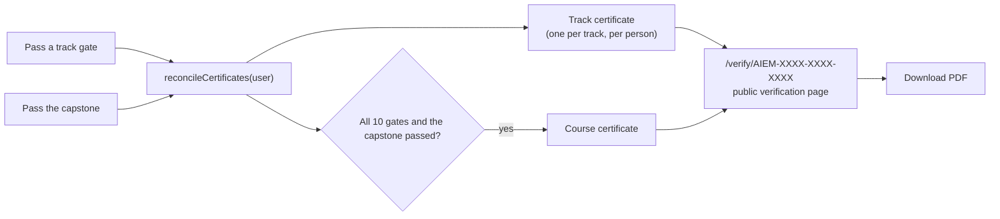
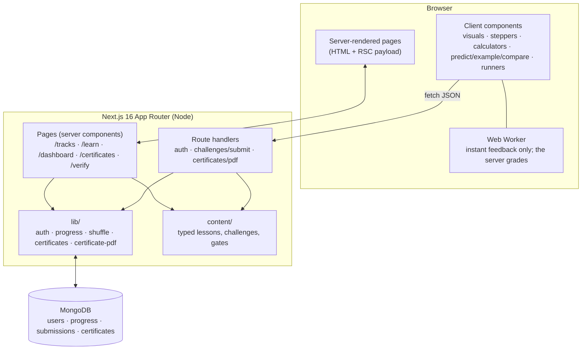
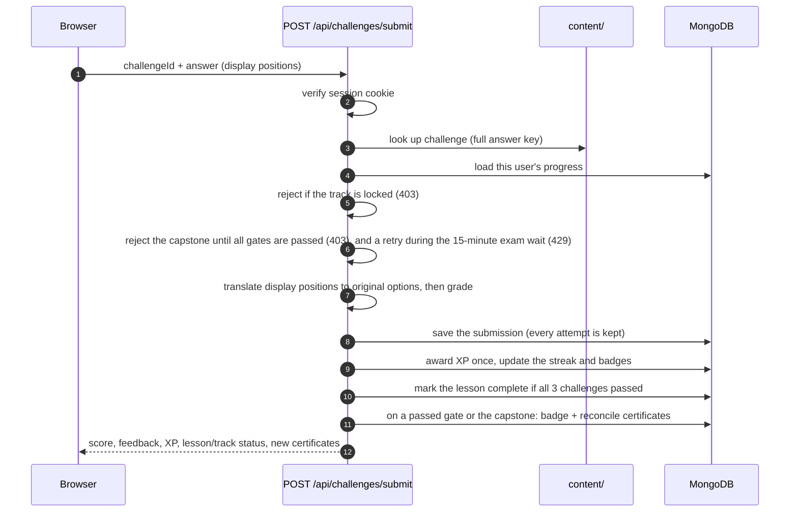
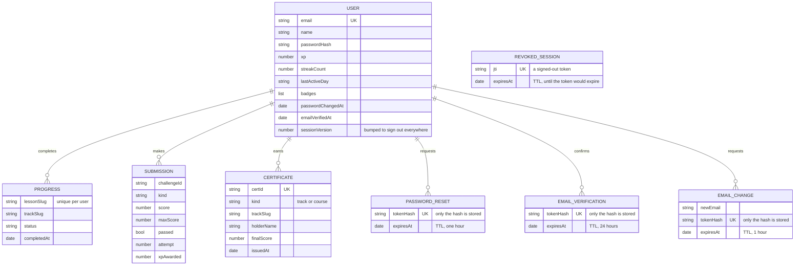
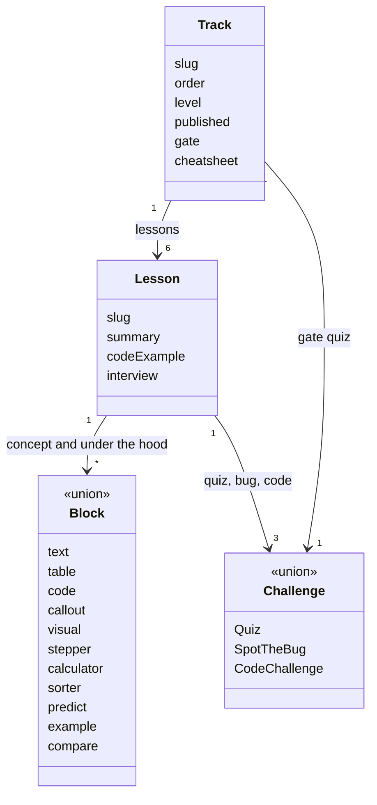

<div align="center">

# AIEM

### AI Engineering Mastery

**An interview-ready AI engineering course you learn by doing:** interactive lessons, scored challenges, track gates and verifiable certificates, from "what is a token?" to operating AI products in production.


[What it is](#what-it-is) · [The curriculum](#the-curriculum) · [Concepts](#core-concepts) · [Architecture](#architecture) · [Getting started](#getting-started) · [Capstone](#the-capstone-and-portfolio-projects) · [Authoring content](#authoring-content) · [Testing](#testing-and-verification) · [Status](#status-and-known-limitations) · [License](#license)

</div>

---

## What it is

AIEM is a full-stack learning platform. A learner signs up, works through ten tracks of lessons, proves each one with scored challenges, passes a gate quiz to unlock the next track, finishes with a **capstone exam**, and earns **public, verifiable certificates** with downloadable PDFs.

| | |
|---|---|
| **10** tracks, beginner to advanced | **60** lessons |
| **191** scored challenges (180 in lessons, 10 gates and the capstone) | **15** bespoke interactive visuals |
| **42** step-throughs, **44** calculators, **44** sorting exercises | **12,000** XP available |
| **60** predict-first questions, **52** worked examples, **12** compare-two exercises | Every lesson has at least two of these |
| A **placement check** and a **mock interview** mode | See [practice tools](#6-practice-tools) |

Every lesson has the same five parts, built so that you can *explain* a topic under interview pressure, not just recognise it:

1. **Concept**: the idea, with something to play with.
2. **Under the hood**: the mechanism interviewers actually probe (formulas, costs, trade-offs).
3. **Code**: a worked example in Python and JavaScript. Examples show the idea and may call helpers they do not define, so not all of them run as they are.
4. **Interview corner**: five real questions, a strong answer, a weak answer, and the likely follow-up.
5. **Challenges**: a quiz, a spot-the-bug exercise and a code challenge, all scored.

> The UI is deliberately **light-mode and strictly grayscale, with no gradients**. Correct and incorrect answers are never shown by colour alone: they use icons, labels and solid-versus-dashed borders, so the interface stays readable for everyone.

---

## The curriculum

Tracks unlock in order. Passing a track's gate (a 10-question quiz, 70% to pass) opens the next one. The lessons are recommended rather than required, so someone who already knows a track can test out with its gate.

| # | Track | Level | Lessons |
|---|---|---|---|
| 1 | **LLM Foundations** | Beginner | What an LLM Actually Does · Tokens & Tokenization · Context Windows & Memory · Sampling, Temperature & Determinism · Transformer Intuition: Attention · Choosing a Model |
| 2 | **Prompt Engineering & Structured Output** | Beginner | Anatomy of a Prompt · Zero-shot, Few-shot & Examples · Reasoning & Chain-of-Thought · Structured Output & Validation · Prompt Injection & Trust Boundaries · Testing & Versioning Prompts |
| 3 | **Embeddings & Vector Search** | Intermediate | What Embeddings Are · Similarity Metrics · Chunking Strategy · Vector Indexes & ANN · Hybrid Search & Reranking · Choosing & Evaluating Embeddings |
| 4 | **RAG Systems** | Intermediate | The RAG Pipeline · Query Understanding · Retrieval Tuning & Context Assembly · Grounding & Citations · RAG Failure Modes & Debugging · Evaluating RAG |
| 5 | **Tool Use & Agents** | Intermediate | Function Calling · The Agent Loop · Planning & Memory · Tool Design & MCP · Multi-Agent Patterns · Guardrails & Reliability |
| 6 | **Evals & Observability** | Advanced | Evals Fundamentals · LLM-as-Judge · Metrics for Generated Text · Regression Testing in CI · Tracing & Observability · Online Evaluation & Feedback Loops |
| 7 | **Fine-tuning & Model Adaptation** | Advanced | When to Fine-tune · Data for Fine-tuning · LoRA & QLoRA · Preference Optimization: RLHF & DPO · Distillation & Small Models · Evaluating & Deploying Fine-tunes |
| 8 | **Production AI** | Advanced | Streaming & Latency · Caching & Cost Control · Reliability: Rate Limits & Retries · Guardrails & Safety · Scaling & Architecture · Operating AI Products |
| 9 | **Advanced RAG & Building It** | Advanced | Vector Databases & pgvector · Advanced Retrieval: Contextual, Parent-Child, Hierarchical & Multi-Hop · RAG Architectures: Naive, Advanced, Modular & Adaptive · Corrective, Self-RAG & Agentic RAG · Graph RAG & Knowledge-Graph Retrieval · Hallucination Detection & Verification · Build It: FastAPI, pgvector, Hybrid Search & Streaming · Frameworks, Document Parsing & Structured Data |
| 10 | **Serving, Self-Hosting & Multimodal AI** | Advanced | How LLM Serving Works: KV Cache, Batching & Throughput · Quantization & Self-Hosting · Multimodal Models: Vision and Audio · Multimodal RAG: Images, PDFs & Audio |

Each track also ships a printable **cheatsheet** at `/cheatsheets/<track>`.

After the tenth gate the **capstone** opens: thirty-six scenario questions on one case study that cut across every track. See [the capstone and portfolio projects](#the-capstone-and-portfolio-projects).

---

## Core concepts

### 1. Learning that is interactive, not a wall of text

Besides ordinary text, tables, callouts and code, a lesson can contain four kinds of interactive block. Most are **data-driven**: a lesson declares the block in plain typed data and a shared component renders it, so adding interactivity to a lesson never needs a new React component.

| Block | What the learner does | Example |
|---|---|---|
| **Visual** (bespoke component) | Manipulate a simulation | Drag a query through an embedding space and watch its nearest neighbours change |
| **Stepper** | Walk forward and back through a process, or auto-play it | HNSW search, RAG debugging, an MCP connection |
| **Calculator** | Move sliders into live formulas | Index storage cost, Little's law for capacity, error budgets |
| **Sorter** | Classify items, then check | "Which retriever finds this?" with an explanation for each item |

Sorters are **practice only**: they are not scored or stored. Scored work happens in the challenges.

### 2. Three kinds of scored challenge

| Kind | How it is graded |
|---|---|
| **Quiz** (the track **gate** and the **capstone**) | On the **server**. Correct answers and explanations are revealed only after a pass. A failed attempt shows which questions were wrong and starts a 15-minute wait before the next try. |
| **Spot the bug** | On the server: the learner picks the buggy line *and* the reason; both are scored. |
| **Code** | On the **server**, in a WebAssembly sandbox (QuickJS) with a memory limit and a 3 s deadline. The browser sends the *code*, never a result. A Web Worker in the browser gives instant feedback while writing, but only the server's run counts. See [limitations](#status-and-known-limitations). |

XP is awarded **once**, the first time each challenge is passed. A lesson is complete when all three of its challenges are passed, and a learner can take a track's gate at any time once that track is unlocked. If a code challenge has them stuck, they can open the reference solution after using every hint; passing it afterwards earns no XP.

### 3. Integrity of the scoring

Because certificates are the product's promise, the scoring is designed so a learner cannot shortcut it from the browser.

- **Answer keys never leave the server.** Content is converted to a client-safe shape before it reaches the browser; correct answers, explanations and reference solutions are absent from the page payload. (This was checked by fetching every lesson page and searching the HTML for answer keys.)
- **Answer positions are shuffled server-side, and balanced.** Hand-written content puts the right answer in the same slot far too often (option B for between 70% and 97% of questions, depending on the track), so "always pick B" would nearly pass a gate. Options are now reordered with a seeded, *balanced* permutation per quiz, so each position is used about equally. The shuffle is deterministic, so the page that serves a question and the route that grades it always agree.
- **Code is run by the server, in a sandbox.** The learner's source is executed in QuickJS compiled to WebAssembly: no `process`, no files, no network, no timers, a 32 MB memory limit and a 3 s deadline. Each grading gets its own engine instance, because QuickJS aborts while shutting down after an out-of-memory error, and a shared one would break every later submission. Code runs are also limited to 20 per account per 5 minutes.
- **The shuffle itself does not leak.** The browser only ever sees *display* positions. The server translates a submitted position back to the original option before grading. (An earlier design that sent original indices to the browser would have revealed the answer; it was removed.)
- **Locks are enforced by the API, not just hidden in the UI.** Submitting to a locked track, or to the capstone before every track gate is passed, returns `403`.
- **Certificates rest on the gates and the capstone**, which are graded on the server, rather than on code-challenge XP.
- **Email features are paused.** Out of the box there is plain signup and login: no email verification, no forgot-password, no change-email, and a certificate is issued the moment a track is passed. The code is kept and switches back on with `ENABLE_EMAIL_FEATURES=1` (plus the Resend settings). While paused, the email endpoints answer 404 and their pages are 404 pages. What follows describes the behaviour when they are on.
- **Email is verified before certificates are issued (when email features are on).** Signup emails a link (valid 24 hours, usable once, stored only as a hash). Until it is opened, a learner can learn and pass challenges, but certificates, which are public and carry their name, are held and then issued automatically on confirmation. The confirmation page asks for a click rather than confirming on load, so a link scanner that merely opens URLs cannot spend the token. Enforcement is on exactly when email is configured, so a deployment without email cannot lock everyone out.
- **Accounts are protected against guessing and floods.** Login, signup and password reset are rate limited per address and, for login and reset requests, per email. Counters live in MongoDB with a TTL index, because serverless instances do not share memory. Password reset tokens are random, stored only as a hash, valid for one hour, usable once, and a reset signs out every session issued before it.

### 4. The capstone and portfolio projects

The capstone is one case study, **Northwind's support copilot**, and thirty-six decisions about it in seven sections: the prompt and interface, grounding in documents, tools and actions, evaluation, adaptation, production, and knowledge bases, self-hosting and multimodal inputs. Each question asks what a good engineer would *do* ("a refund call timed out and the customer was refunded twice; what should have been in place?"), not what a term means, and each section draws on several tracks.

| | |
|---|---|
| Pass mark | **75%** (the track gates use 70%) |
| XP | 400, awarded once |
| Opens | after all ten track gates are passed |
| Grading | on the server, with the same shuffled, non-leaking answer positions as the gates |

Alongside it are five **portfolio project briefs** (a streaming chat app, a cited document Q&A bot, a guardrailed research agent, an evaluation harness, and a capstone support copilot). Each has tickable requirements, stretch goals, what to put in the README, and the questions an interviewer is likely to ask. **They are not graded**: the server cannot safely run what a learner builds, so nothing there counts toward the certificate, and the ticks are saved only in the learner's browser.

### 5. Certificates



- **Public verification.** `/verify/<id>` shows the holder, credential, score and date to anyone with the link, plus a lookup form at `/verify`. A well-formed but unknown ID gets a friendly 404. If the database is unreachable the page says verification is *temporarily unavailable* rather than wrongly claiming the certificate is fake.
- **IDs are unguessable and readable.** Format `AIEM-7K3Q-ZB2M-X9HD`: 12 random symbols from a 32-character alphabet with the look-alikes `I`, `O`, `0`, `1` removed. Each symbol is `byte % 32` of a random byte, which is exactly uniform because 256 is a multiple of 32.
- **The course certificate needs all ten gates and the capstone**, and its score is the capstone score. A capstone pass without the gates issues nothing.
- **Issuing is idempotent and self-healing.** One function, `reconcileCertificates`, issues whatever a person has earned and doesn't yet hold. It runs when a gate or the capstone is passed *and* when the certificates page loads, so a failed issue, or gates passed before certificates existed, are filled in on the next visit. A unique index on `(user, kind, track)` makes concurrent requests safe: the loser of a race simply reads the winner's certificate.
- **A real PDF**, generated server-side with [`pdf-lib`](https://pdf-lib.js.org/): A4 landscape and grayscale, with no colour or gradients. It has a layered frame with a dotted band and corner ornaments, a faint rosette watermark (a different one for each track), serif lettering, a scalloped seal with ribbon tails showing the track number and level (a star for the course certificate, which also gets an extra frame), the date, the certificate id, and a **QR code** that opens the verification page (the printed link is the fallback if a link is too long to encode). Long names wrap to two lines and absurd ones are truncated with an ellipsis, so text can never overflow the frame. The on-screen certificate on the verify page uses the same design in CSS and SVG.
- **Honest wording.** Certificates state they are for completing the course material and passing its assessments, and that they are *not an accredited qualification*.

---


### 6. Practice tools

- **Placement check** (`/assess`): twenty questions, two per track, from fundamentals upward. It suggests the first track you were not solid in and shows a score per track. It is advisory: nothing is scored or saved, and it unlocks nothing itself. To skip ahead, a learner passes each earlier track's gate.
- **Mock interview** (`/interview`): reading an answer is not the same as giving one. You are asked a real interview question from the lessons, write the answer you would say out loud, then compare it with a strong answer and a common shallow one. A key-term check shows which distinctive words of the strong answer you used, as **word overlap and not a grade**, and you rate yourself. At the end you get the lessons to revisit. There is no model call involved, so it cannot be fooled or run up a bill, but it also cannot judge meaning, which is why the rating is yours.

- **Live voice interview** (`/interview/live`): a spoken interview with an AI interviewer, for signed-in learners, limited to three a day. It opens with a short introduction, asks questions from the course out loud, follows up on what the candidate actually said, gives no feedback along the way, and ends with a scorecard.

| Step | Model |
|---|---|
| Hearing the answer | Sarvam `saaras:v4` |
| Choosing the next move (follow up, press on a gap, hint, repeat, move on, stop) | Sarvam Prism (`sarvam-prism`), within limits set in `live-interview-core.ts` |
| Writing what the interviewer says | Sarvam `sarvam-105b-conversations` |
| Speaking | Sarvam `bulbul:v4-flash` |
| Writing the scorecard | Claude Sonnet 5.5 (`claude-sonnet-5-5`) |

Interviews are 3 (quick) or 10, 15 or 20 questions; long ones run in two or three rounds with a pause between them. Every interview question is tagged easy, medium or hard (`src/content/interview-difficulty.ts`, drafted by `scripts/tag-interview-difficulty.mjs` and open to correction). The first question matches the chosen starting level; after each one, Prism's 0-3 rating of the answers moves the next question up or down a level. Easy questions get one follow-up, harder ones two. The overall score weights hard questions three times as much as easy ones, and the scorecard reports the hardest level handled reliably.

Cost controls: the main questions and the closing line are fixed text, so they need no conversation-model call and their audio is generated once and replayed from `SpeechCache`; silence is trimmed from answers in the browser before speech recognition, which bills by the minute; the scorecard reuses the course's strong answers instead of writing new ones; and accounts get 3 quick interviews and 1 long one a day. A real 10-question run (November 2026) used about 2,200 characters of speech, 4 minutes of recognition and 4,600 input / 1,800 output Sonnet tokens.

It needs `SARVAM_API_KEY` and `ANTHROPIC_API_KEY`, both server-side only. If a Sarvam decision or conversation call fails, the interview continues with built-in rules and scripted lines. Audio is never stored; transcripts and scorecards expire after 180 days and can be deleted. The reference answers never reach the browser during an interview. To test with no keys or cost, run `scripts/mock-voice-apis.mjs` (its header explains how) and then `npm run test:live-interview-api`.

## Architecture

### System overview



Key decisions:

- **Content is typed TypeScript, not a CMS or MDX.** Every lesson is forced into the same five-section shape, the grader reads from the *same source* the page renders, and a compiler error catches a malformed lesson.
- **Server components by default.** Pages read the session cookie and progress on the server; only genuinely interactive pieces are client components.
- **No caching of per-user pages.** The session cookie is read on almost every page, so Next's *Cache Components* mode is switched off (it would force a `<Suspense>` boundary around nearly everything for no benefit).
- **Own session handling instead of an auth framework.** A signed, `httpOnly`, `sameSite=lax` JWT cookie (via [`jose`](https://github.com/panva/jose)) and `bcryptjs` password hashes. Small enough to read in one sitting.

### Submitting a challenge



### Data model



`Certificate` has a unique compound index on `(userId, kind, trackSlug)`, and `Progress` on `(userId, lessonSlug)`, so both are safe under concurrent requests. Progress and unlock state are *derived* from submissions rather than stored separately, so they cannot drift out of sync with the evidence.

### Content model



Type definitions live in [`src/content/types.ts`](src/content/types.ts).

### Project structure

```
.
├── scripts/                      Verification and test scripts (npm run verify)
├── src/
│   ├── app/
│   │   ├── (auth)/               login, signup (full-screen layout)
│   │   ├── (site)/               everything else, with header and footer
│   │   │   ├── tracks/           track list and track pages (with gates)
│   │   │   ├── learn/[track]/[lesson]/   the five-section lesson page
│   │   │   ├── capstone/         the final exam and the portfolio project briefs
│   │   │   ├── assess/           the placement check
│   │   │   ├── interview/        the mock interview mode
│   │   │   ├── account/          email change and sign out everywhere
│   │   ├── dashboard/        XP, streak, badges, resume, capstone and certificates links
│   │   │   ├── certificates/     "my certificates" (reconciles, then lists)
│   │   │   ├── verify/           public lookup and /verify/[certId]
│   │   │   └── cheatsheets/      printable per-track cheatsheets
│   │   └── api/
│   │       ├── auth/             signup · login · logout · forgot · reset · verify-email
│   │       ├── account/          change-email · confirm-email-change · signout-all
│   │       ├── health/           deployment configuration as booleans
│   │       ├── challenges/submit/   server-side grading
│   │       └── certificates/[certId]/pdf/   PDF download
│   ├── components/
│   │   ├── visuals/              15 bespoke interactive visuals + registry
│   │   ├── interactive/          Stepper · Calculator · Sorter (data-driven)
│   │   ├── challenges/           Quiz / Bug / Code runners, Web Worker (public/code-worker.js)
│   │   └── …                     BlockRenderer, CertificateCard, Logo, header
│   ├── content/
│   │   ├── types.ts              the content schema
│   │   ├── extras/               predict, worked-example and compare blocks, per lesson slug
│   │   ├── capstone.ts           the 36-question capstone exam
│   │   ├── assessment.ts         the 20 placement questions
│   │   ├── projects.ts           portfolio project briefs
│   │   ├── index.ts              track registry, lookups, client-safe serialisation
│   │   └── tracks/<track>/       index.ts (gate, cheatsheet) + lessons/01…06
│   ├── lib/                      auth · db · progress · shuffle · certificates*
│   └── models/                   Mongoose: User · Progress · Submission · Certificate
└── .env.example
```

### Tech stack

| Concern | Choice |
|---|---|
| Framework | Next.js 16 (App Router, Turbopack), React 19, TypeScript |
| Styling | Tailwind CSS 4 with a small design-token layer in `globals.css` |
| Animation | Framer Motion, plus SVG |
| Database | MongoDB via Mongoose 9 |
| Auth | Signed JWT cookie (`jose`), `bcryptjs` |
| Validation | Zod 4 |
| PDF and QR code | `pdf-lib`, `qrcode` |
| Icons | `lucide-react` |

---

## Getting started

### Prerequisites

- **Node.js 20.9 or newer** (developed on Node 24)
- **MongoDB**: the quickest way is Docker

```bash
docker run -d --name aiem-mongo -p 127.0.0.1:27017:27017 -v aiem-mongo-data:/data/db mongo:7
```

### Run it

```bash
git clone https://github.com/sairaghukiran14/AIEM.git
cd AIEM
npm install
cp .env.example .env.local
```

Generate a session secret and put it in `.env.local` as `AUTH_SECRET`:

```bash
node -e "console.log(require('crypto').randomBytes(32).toString('hex'))"
```

Then:

```bash
npm run dev      # http://localhost:3000
```

### Environment variables

| Variable | Required | Purpose |
|---|---|---|
| `MONGODB_URI` | yes | Connection string, e.g. `mongodb://127.0.0.1:27017/ai-engineering-mastery` |
| `AUTH_SECRET` | yes | Signs session cookies. Use a long random value. |
| `REVIEW_UNLOCK_ALL` | no | Set to `1` to open every track without passing gates, for reviewing content. **Ignored in production builds.** |
| `DEV_ALLOWED_ORIGINS` | no | Extra hostnames allowed to load the dev server (comma separated). |
| `TRUST_PROXY_HEADERS` | when self-hosting behind a proxy | `1` makes the rate limiter believe `X-Forwarded-For`. It is trusted automatically on Vercel. Anywhere else the header is something the caller can set, so without this the per-address limits are skipped and only the per-account limits apply. |
| `ENABLE_EMAIL_FEATURES` | no | `1` switches on email verification, forgot password and change email. Off by default. Needs the Resend settings below. |
| `REQUIRE_EMAIL_VERIFICATION` | no | `1` holds certificates until the person confirms their email, `0` turns it off. By default it is on exactly when email is configured. |
| `SITE_URL` | no | Public origin used in certificate verification URLs and password-reset links. Defaults to the request's origin. |
| `RESEND_API_KEY`, `MAIL_FROM` | only with `ENABLE_EMAIL_FEATURES=1` | Send email through [Resend](https://resend.com). `MAIL_FROM` is the sender, such as `AIEM <no-reply@yourdomain.com>`. Without them, development logs the reset link to the server console, and production logs an error and sends nothing. |

> **Dev-server gotcha.** Next.js blocks dev-server resources for any host except `localhost`. If you open the app by another hostname or a LAN address, the page renders but never becomes interactive and every button is dead. `127.0.0.1` and `192.168.x.x` are allowed by default; add anything else to `DEV_ALLOWED_ORIGINS`.

### Scripts

| Command | What it does |
|---|---|
| `npm run dev` | Start the dev server |
| `npm run build` / `npm start` | Production build and server |
| `npm run lint` | ESLint |
| `npm run typecheck` | TypeScript, no emit |
| `npm run verify` | Everything below, in one go |
| `npm run e2e` | End-to-end checks against a running server and a real MongoDB (see below) |
| `npm run edge` | Edge-case and security checks against a running server, including a live deployment (see below) |

---

## Authoring content

Adding a lesson means writing one typed file. The compiler and the verification scripts then check it.

```ts
// src/content/tracks/<track>/lessons/07-my-lesson.ts
import type { Lesson } from "@/content/types";

export const lesson: Lesson = {
  slug: "my-lesson",              // must be unique across ALL tracks
  order: 7,
  title: "My Lesson",
  summary: "One sentence on why it matters.",
  minutes: 12,

  concept: [
    { type: "p", text: "Inline `code`, **bold** and *italic* are supported." },
    { type: "visual", key: "tokenizer", caption: "Try it." },
    {
      type: "calculator",
      title: "What does it cost?",
      inputs: [{ key: "n", label: "Requests", min: 1, max: 1000, step: 1, value: 100 }],
      outputs: [{ label: "Total", formula: "n * 3", format: "int" }],
    },
  ],
  underTheHood: [ /* blocks */ ],
  codeExample: { language: "python", code: "..." },
  interview: [ /* 5 × { question, answer, weakAnswer?, followUp? } */ ],
  challenges: [ /* quiz, spot-the-bug, code */ ],
};
```

Then register it in the track's `index.ts`.

**Practice blocks** (`predict`, `example`, `compare`) live apart from the lessons, in `src/content/extras/<track>.ts`, keyed by lesson slug. `concept` extras are appended to the end of the concept section and `underTheHood` extras to the end of the under-the-hood section, so an existing lesson file never needs editing. A `predict` is a question with instant feedback, an `example` is a worked problem revealed one step at a time, and a `compare` asks the learner to pick the better of two versions. All three are practice only. Option and side positions are shuffled with a seed so the correct one is not always in the same place. To add a whole track, create `src/content/tracks/<slug>/` with a gate and cheatsheet, and add it to the list in `src/content/index.ts`.

Conventions that keep the course consistent:

- **Challenge ids** are `<prefix>-<n>-quiz | bug | code`, `<prefix>-gate` and `capstone-exam`.
- **Quiz answer positions don't matter.** Write the correct option anywhere; the server balances positions at serve time.
- **Code challenges** need a reference `solution` and tests. Tests compare results with `JSON.stringify`, so **object key order in expected values matters**; document the order in the starter.
- **Calculator formulas** are JavaScript expressions over the input keys. They are authored in this repository and evaluated in the browser, so they must never come from user input.
- **Be honest in copy.** Visuals that use made-up numbers say so on the page.

---

## The quiz

`/quiz` is a practice bank of **1,019 questions** across eleven topics, from LLM fundamentals through retrieval, agents, evals and fine-tuning to production, serving and scaling, plus a decision-making set and a debugging playbook. Each question is one of four types (**concept**, **decision**, **debugging**, **yes or no**) at one of three levels (easy, medium, hard).

- **Build your own quiz:** pick a topic (or everything), a difficulty (mixed runs easy to hard), a type, and 10, 20, 30 or 50 questions. New quizzes avoid questions from the learner's last 15 quizzes while unseen ones remain.
- **Feedback and score:** the right answer and the reasoning appear after each question. Easy questions score 1 point, medium 2, hard 3, and a skip scores 0. The result page shows the percentage, a rating, a breakdown by difficulty, type and topic, a link to the matching track for the weakest topic, and a full review. The quiz page keeps the best score, average, recent quizzes and how many questions the learner has mastered.
- **Server-side grading.** The browser receives questions in a per-attempt shuffled order with no answer key. Each answer is posted, graded on the server and stored once (two simultaneous answers cannot both count); the key and explanation come back only after a question is answered. Unfinished quizzes resume and expire after three days. Quizzes are practice: they do not unlock tracks or certificates.
- **Authoring.** Questions live in `src/content/quiz/<topic>.ts` as one-line calls: `c`, `d` and `b` take the level, the prompt, the **correct** option first, three wrong options and an explanation; `y` takes the level, the prompt, `true` or `false`, and an explanation. Append new questions to the end of a file so ids stay stable. `npm run verify:quiz` checks the bank like data: counts per topic, type and level, four different options, no "all of the above", no duplicate prompts, balanced yes/no answers, and that the right option is not the longest (or shortest) too often.

## Testing and verification

`npm run verify` runs a suite designed around one idea: **the content is data, so check it like data.**

| Script | What it proves |
|---|---|
| `check-structure` | Challenge ids and lesson slugs are unique; every answer index and buggy-line number is in range; the capstone is well-formed (four options, explanation and scenario on every question); the placement check has exactly two questions per track; every project brief points at a real track |
| `check-blocks` | Every calculator formula evaluates to a number with its defaults; every step-through highlight points at a real item; every sorter answer is a valid category; every visual key exists; every lesson has practice blocks in `extras` with in-range answers and complete steps; every lesson has at least one interactive element, five interview questions and three challenges |
| `test-solutions` | **Every code challenge's reference solution passes its own tests**, and its starter code does *not* (so no challenge is trivially solved). This caught several wrong expected values while the course was written |
| `report-answer-balance` (as `verify:balance`) | **Fails** if the correct answers are lopsided after the server shuffle: each position must hold 20-30% of lesson-quiz answers, 15-35% of bug reasons, and each gate at most a quarter plus one |
| `test-interview-terms` | The key-term logic behind the mock interview: word stemming, which terms count as distinctive, and overlap percentages |
| `test-rate-limit-and-mail` | The rate limiter's window and decision logic, how the client address is read, and the email request that would be sent |
| `test-certificates` | Certificate issuing against an in-memory store with the same unique-index behaviour as MongoDB: idempotency, the course certificate requiring the capstone (and carrying its score), a simulated race, an ID collision, ID uniformity |
| `test-certificate-pdf` | PDFs build and re-open from awkward input: non-Latin names, emoji, very long names, 200 characters with no spaces, an empty name, every seal variant, and a link too long for a QR code; each PDF stays under a size limit |

**Paused mode (`npm run test:paused`)** runs against the default server and checks that the email endpoints and pages are 404, that signup and login work with no email prompts, and that passing a gate issues the certificate at once. **End-to-end (`npm run e2e`)** needs a built server started with `ENABLE_EMAIL_FEATURES=1` and a database, so it is not part of `verify`, but CI runs it on every push against a MongoDB container. It creates throwaway users and checks: signup and login, the rate limit (the 9th wrong password for one address gets a 429), the full password-reset flow (only a token hash is stored, a link works once, an expired or unknown link is refused, and a session from before the reset is signed out), email verification (a link works once, only a hash is stored, opening the page does not spend it, and a certificate is held until the address is confirmed and then released), track and capstone locks, every gate with wrong and right answers, the course certificate, its public page and its PDF. It deletes everything it created.

**Edge cases (`npm run edge`)** targets what usually breaks in production, and is safe to point at a live site (`BASE_URL=https://... npm run edge`, against a server with `ENABLE_EMAIL_FEATURES=1`) because every account uses Resend's test recipient and it deletes what it creates. It covers: malformed and hostile input (invalid JSON, operator objects instead of strings, 2 MB bodies, over-long names, emails and passwords, email case and unicode); concurrency (simultaneous signups, a burst of wrong logins from many addresses, simultaneous passing submissions, simultaneous use of one reset link); sessions (tampered, garbage and `alg: none` tokens, cookie flags, redirects, open-redirect attempts, and that a cookie outliving its account or signed out by a password reset shows the login form instead of looping between pages); challenge submissions with nonsense answers; server-side code grading (the starter fails, the solution passes, an infinite loop, a memory bomb, runaway recursion and sandbox escapes all fail safely, and the XP is awarded once); session revocation, sign out everywhere and the full email-change flow; body-size, attempt and rate limits; login timing; the Content-Security-Policy (a fresh nonce on every request and on every inline script, and the worker's own policy); certificates for names in other alphabets read back out of the real PDF; script-like names rendered on every page and in the PDF; malformed certificate ids; that no page leaks an answer key or solution; locked content; 404s; and the security headers.

A live deployment can report its own configuration at `/api/health` (booleans only: database reachable, `AUTH_SECRET` set, email configured, `SITE_URL` set).

Beyond these, every page was fetched and checked for a `200`, no lock screen, an interview section, and **no answer keys in the HTML**, and each interactive component was exercised with real clicks and drags in a browser.

---

## Status and known limitations

Being upfront about what this is and isn't:

**Built:** all 10 tracks, the capstone exam, the placement check, the mock interview mode, portfolio project briefs, auth, server-side grading, progress, XP, streaks, badges, track gates, per-track cheatsheets, certificates with public verification and PDF.

**Not built yet**

- A hands-on build-along lesson for model serving (vLLM and a GPU); Track 10 covers serving as ideas and arithmetic.
- Hidden test cases for code challenges (see limitations).
- Certificate PDFs for scripts beyond Latin, Greek, Cyrillic, Vietnamese and Devanagari (see limitations).

**Known limitations**

- **Sessions are checked against the database on every request.** Logout revokes that one token (a copied cookie stops working), a password reset or "Sign out everywhere" bumps a version on the account and signs out every device, and changing the email address does the same. The cost is one extra database read per request.
- **The Content-Security-Policy allows inline styles.** Scripts need a fresh per-request nonce (`src/proxy.ts`), with no `unsafe-inline` and, in production, no `unsafe-eval`. Styles still allow `unsafe-inline`, because React and the animation library write style attributes, which a nonce cannot cover. The code-challenge worker is the only place `eval` is allowed, from its own file with its own policy that forbids all network access.
- **Rate limits use fixed windows and are keyed by address.** The per-address login limit (8 wrong attempts in 15 minutes) also means someone can lock a known email out for 15 minutes by guessing wrong on purpose. That trade-off was chosen over allowing unlimited guessing. Limits depend on the platform's forwarded-address header, which Vercel sets.
- **There is no password reset while email features are paused.** A forgotten password cannot be recovered. When switched on, password reset needs an email provider. Without `RESEND_API_KEY` and `MAIL_FROM` in production, no email is sent. The form still shows its neutral message, so the failure is only visible in the server logs.
- **Portfolio projects are not graded.** They are briefs with self-ticked checklists, saved only in the browser, and they do not affect the certificate.
- **Code challenge tests are visible.** The server now runs the code itself, so a pass cannot be claimed without code that returns the right values. But the test cases are shown to the learner, so someone determined can write code that special-cases them. Hidden tests would close that and mean writing a second set of tests for every challenge. Certificates depend on gates and the capstone, which are not affected.
- **The sandbox is not Node.** QuickJS supports modern JavaScript but not browser or Node APIs. Every reference solution is checked in it (`npm run verify`), but a learner's code that passes in their browser could use something the sandbox lacks. The result tells them which test failed and why.
- **Labs are simulated.** Visuals use hand-made or toy data (and say so); there are no live model calls.
- **Certificate PDFs cover some scripts, not all.** Latin, extended Latin, Vietnamese, Greek, Cyrillic and Devanagari names print correctly, using bundled Noto Serif fonts for the letters the standard font lacks. Other scripts (for example CJK, Arabic, Hebrew, Thai and Telugu) print as `?` in the PDF; the web page shows every name correctly. Telugu was tried and its letter joining came out wrong, so it is deliberately not claimed.
- **Login and signup timing.** An unknown email now costs the same time as a known one. Signup still says when an address is already registered, which is a deliberate usability trade-off.
- **Public by design:** a certificate's link exposes the holder's name, credential, score and date to anyone who has it.


---

## License

Released under the [MIT License](LICENSE). You may use, copy, modify and distribute this project, including the course content, provided the copyright notice is kept.
